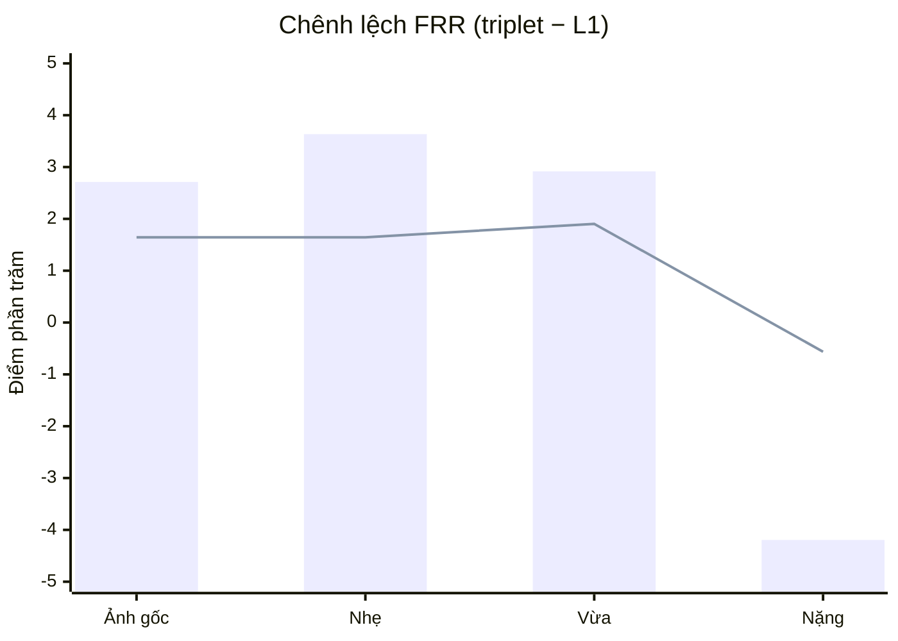
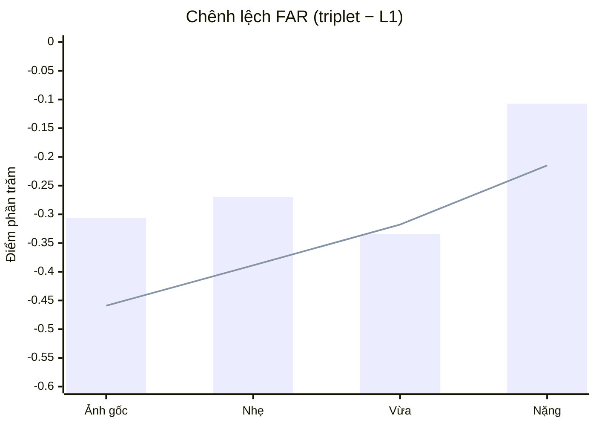

# Kết quả thực nghiệm — Phục hồi vân tay với triplet loss

**Kết quả chính:** Ở mức suy giảm nặng mô phỏng, U-Net L1 + triplet giảm FRR và FAR trung bình trên cả hai tập test. FVC2004 **PASS**; FVC2000/2002 **FAIL** vì FAR tăng ở một DB. Với ảnh gốc và hai mức nhẹ hơn, triplet giảm FAR trung bình nhưng tăng FRR trung bình trên cả hai tập.

## 1. Thiết kế thực nghiệm

- **Câu hỏi:** Dùng triplet dựa trên DMD để huấn luyện trực tiếp bộ phục hồi có cải thiện xác minh vân tay bằng NBIS so với cùng U-Net chỉ dùng L1 không?
- **Đối chứng:** Hai nhánh U-Net dùng chung khởi tạo và ngân sách hai epoch trong mỗi seed; DMD giữ cố định, chỉ U-Net được cập nhật. Hai test sử dụng checkpoint seed `20261127`, chọn theo MAE validation: L1 epoch 1 và L1 + triplet epoch 2. Raw (không phục hồi) và Gabor là đối chứng **validation**, không có trong hai test.
- **Suy giảm:** Từ ảnh thu bằng cảm biến, simulator làm mỏng vân tối rồi pha vùng chịu tác động về trắng qua mặt nạ loang. Tham số chọn vùng nhẹ/vừa/nặng là `0.15/0.30/0.45`, độ làm nhạt `0.40/0.65/0.85`, cửa sổ `3/3/5` px. Chỉ biến đổi probe; giữ nguyên gallery. Pilot trên 12 probe train ghi nhận điểm NBIS giảm trung vị 7 / 26,5 / 57,5 theo ba mức. Đây là kiểm tra độ khó, không phải hiệu chuẩn trên da khô thật. [Simulator và pilot](./06_structured_degradation_pilot.ipynb).
- **So khớp:** Gallery là lần lấy dấu thứ nhất, probe là lần 2–8, ghép trong từng DB. Dùng NBIS MINDTCT + BOZORTH3, PNG 500 DPI và tối thiểu 10 minutiae. FRR là tỷ lệ từ chối cặp cùng ngón; FAR là tỷ lệ chấp nhận cặp khác ngón. Cặp không so được tính là từ chối. Số macro là trung bình đều theo DB.

| Tập | DB | Gallery | Probe | Cặp cùng ngón | Cặp khác ngón |
|---|---|---:|---:|---:|---:|
| Validation FVC2000/2002 | DB1–DB3 mỗi năm | 134 | 938 | 938 | 20.580 |
| Test giữ lại FVC2000/2002 | DB1–DB3 mỗi năm | 145 | 1.015 | 1.015 | 24.388 |
| Test ngoài FVC2004 | DB1–DB3, Set A+B | 330 | 2.310 | 2.310 | 251.790 |

Số cặp tính cho **mỗi điều kiện**. Khoá split theo ID ngón trong DB và nhóm ảnh trùng byte; không khẳng định độc lập theo người xuyên DB/năm. [Quy tắc chia tập](./03_lock_data_splits.ipynb).

## 2. Validation — Baseline và lặp lại theo seed

Trung bình đều 6 DB và ba mức suy giảm mô phỏng, không gồm ảnh gốc. Dùng cùng ngưỡng theo DB đã chọn từ ảnh gốc, không cân lại FAR cho từng mô hình.

| Phương pháp | FRR (%) | FAR (%) |
|---|---:|---:|
| Raw | 32,142 | 0,368 |
| Gabor | 38,905 | 0,564 |
| U-Net warmstart | 20,865 | 0,576 |
| L1, seed gốc | 19,758 | 0,584 |
| L1 + triplet, seed gốc | 18,121 | 0,603 |
| L1 + mean-risk, seed gốc | 20,648 | 0,529 |
| L1 + tail-risk, seed gốc | 20,174 | 0,533 |
| L1, seed lặp | 20,491 | 0,601 |
| L1 + triplet, seed lặp | 18,571 | 0,629 |

**Riêng mức nặng:** Ở ngưỡng gốc, triplet so với L1 giảm FRR **5,269 / 7,169 điểm %** (seed gốc / seed lặp), nhưng tăng FAR **0,044 / 0,110 điểm %**. Khi phân tích lại validation với **trần FAR chung theo mỗi DB** (trần lấy từ số nhận nhầm của L1 ở ngưỡng gốc), FRR vẫn giảm **36,34% → 33,10%** và **38,65% → 35,81%**. Trần chung không có nghĩa FAR thực đo bằng nhau.

So với raw, cả pipeline L1 + triplet ở seed gốc giảm FRR trung bình **14,02 điểm %**, đổi lấy FAR tăng **0,235 điểm %**. Đây không phải lợi ích riêng của triplet. Gabor đã thử kém raw trên cả hai tỷ lệ; không suy rộng sang mọi cấu hình Gabor.

Nguồn: [Gabor](./16_gabor_validation_matching.ipynb), [seed gốc](./38_native_counterfactual_nbis_validation.ipynb), [seed lặp](./40_native_triplet_replication_validation.ipynb) và [đối chiếu validation](./43_triplet_literature_gap_review.md).

## 3. Test đã khóa — Đủ bốn điều kiện

Hai test không chỉnh ngưỡng theo điểm test. FVC2000/2002 dùng ngưỡng riêng theo DB và mô hình; FVC2004 dùng trung vị các ngưỡng validation đã khóa (20 cho L1, 22 cho triplet). Điều kiện chính là hỏng nặng: **FRR macro giảm nghiêm ngặt và không DB nào tăng FAR**. Hai bộ ngưỡng khác nhau, nên không quy toàn bộ khác biệt giữa hai test cho dataset.

| Tập | Điều kiện | FRR L1 (%) | FRR triplet (%) | FAR L1 (%) | FAR triplet (%) |
|---|---|---:|---:|---:|---:|
| FVC2000/2002 | Ảnh gốc | 10,7765 | 13,4883 | 0,7130 | 0,4065 |
| FVC2000/2002 | Nhẹ | 10,1793 | 13,8140 | 0,6589 | 0,3895 |
| FVC2000/2002 | Vừa | 11,7018 | 14,6184 | 0,5984 | 0,2642 |
| FVC2000/2002 | **Nặng — FAIL** | **37,7610** | **33,5655** | **0,1836** | **0,0763** |
| FVC2004 | Ảnh gốc | 15,9740 | 17,6190 | 0,9750 | 0,5159 |
| FVC2004 | Nhẹ | 17,4459 | 19,0909 | 0,8658 | 0,4770 |
| FVC2004 | Vừa | 17,9654 | 19,8701 | 0,7780 | 0,4603 |
| FVC2004 | **Nặng — PASS** | **38,6147** | **38,0519** | **0,4980** | **0,2832** |

**Hình 1.** Thay đổi FRR khi thêm triplet (triplet trừ L1, điểm phần trăm). Trong mỗi hình, **cột = FVC2000/2002; đường = FVC2004**. Âm là giảm lỗi.

**Hình 2.** Thay đổi FAR khi thêm triplet. FAR macro giảm ở mọi mức; đồ thị macro không cho thấy DB tăng FAR ở test FVC2000/2002.

### Đọc kết quả theo DB ở mức nặng

Xem [số đếm đầy đủ cho Bảng 5 và khoảng bất định ghép cặp FVC2004](./48_fingerprint_submission_evidence.md).

**FVC2000/2002 — FAIL:** FVC2000/DB2 giảm từ chối nhầm **31 → 27 / 119** cặp cùng ngón nhưng tăng chấp nhận nhầm **3 → 4 / 1.904** cặp khác ngón. Mức tăng ròng một lượt đủ để không đạt tiêu chí đã khóa; không phải bằng chứng FAR tăng có ý nghĩa thống kê.

**FVC2004 — PASS:** DB2 đóng góp phần lớn mức giảm từ chối nhầm; DB3 đóng góp phần lớn mức giảm chấp nhận nhầm nhưng có thêm một lượt từ chối nhầm.

| DB | Từ chối nhầm L1 → triplet (/770 cặp cùng ngón) | Chấp nhận nhầm L1 → triplet (/83.930 cặp khác ngón) |
|---|---:|---:|
| DB1 | 312 → 308 (−4) | 290 → 191 (−99) |
| DB2 | 395 → 385 (−10) | 178 → 112 (−66) |
| DB3 | 185 → 186 (+1) | 786 → 410 (−376) |
| **Tổng** | **892 → 879 (−13)** | **1.254 → 713 (−541)** |

Ở FVC2004, 135 cặp cùng ngón chuyển sang chấp nhận, 122 chuyển sang từ chối; 902 cặp khác ngón được chặn thêm, 361 chuyển sang chấp nhận. Kết quả mức nặng không đổi khi loại ảnh trùng byte.

Nguồn: [giao thức test giữ lại](./41_triplet_heldout_test_protocol.md), [kết quả test giữ lại](./41_triplet_heldout_results.md), [giao thức FVC2004](./45_fvc2004_external_protocol.md), [Notebook FVC2004](./45_fvc2004_external_nbis_test.ipynb). Bảng tổng hợp lấy từ các báo cáo đã lưu; không chạy lại test.

## 4. SOCOFing — Pilot khả thi, không phải test hiệu năng

[Pilot](./44_socofing_nbis_feasibility_pilot.ipynb) chạy trên 12 người, với gallery gốc và các probe được tạo từ chính ảnh gốc đó. Chỉ **19/120 gallery** đủ 10 minutiae theo NBIS hiện tại.

| Phương pháp | Probe đủ minutiae (/993) | Cặp cùng ngón có điểm (/993) | Cặp mức Hard có điểm (/291) |
|---|---:|---:|---:|
| Raw | 119 | 41 (4,13%) | 7 |
| L1 | 189 | 56 (5,64%) | 17 |
| L1 + triplet | 170 | 55 (5,54%) | 17 |

Độ phủ quá thấp để SOCOFing là phép thử FRR/FAR hữu ích với cấu hình NBIS hiện tại. Có điểm không có nghĩa xác minh đúng; pilot không cho biết triplet có tổng quát hóa sang SOCOFing hay không.

## 5. Kết luận sử dụng trong bài

Triplet giúp giảm FRR trung bình ở mức hỏng nặng mô phỏng trên hai tập test, nhưng mức lợi khác nhau và không bảo đảm FAR không tăng ở mọi DB. FVC2004 xác nhận chuyển sang **bộ dữ liệu khác dưới cùng mô phỏng**, không xác nhận chuyển sang da khô thật hay kiểu hỏng mới. Số liệu là ước lượng điểm; các cặp dùng chung probe hoặc gallery, nên PASS/FAIL không thay thế khoảng bất định hay kiểm định thống kê. Không dùng kết quả để tuyên bố thay L1 làm mặc định chung.
